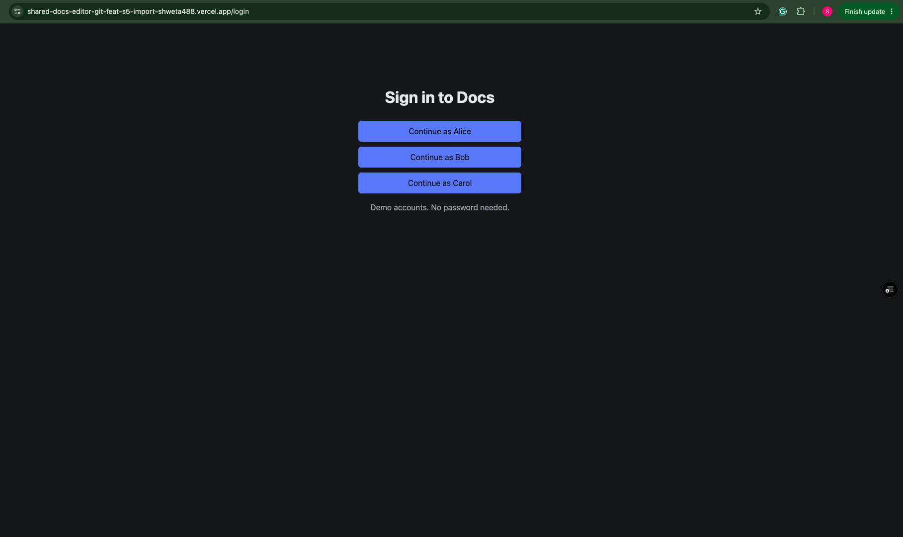
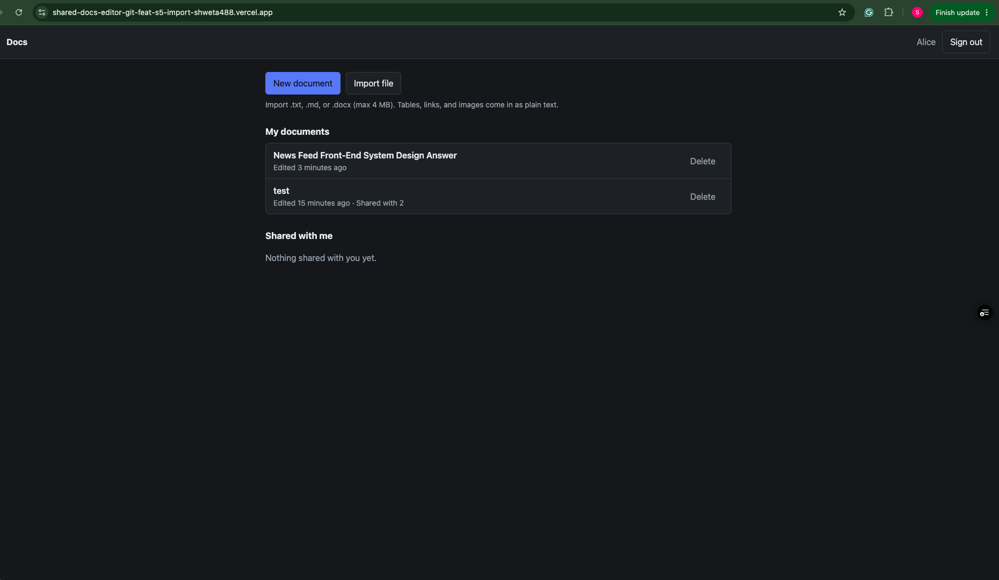
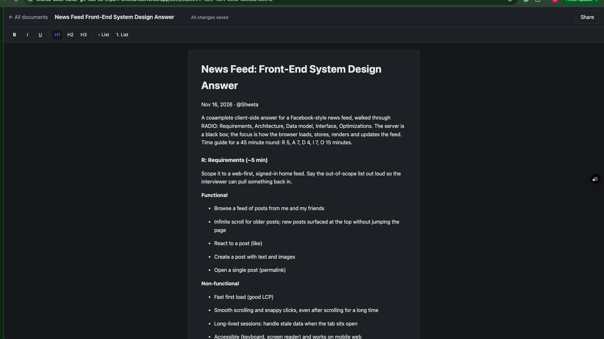
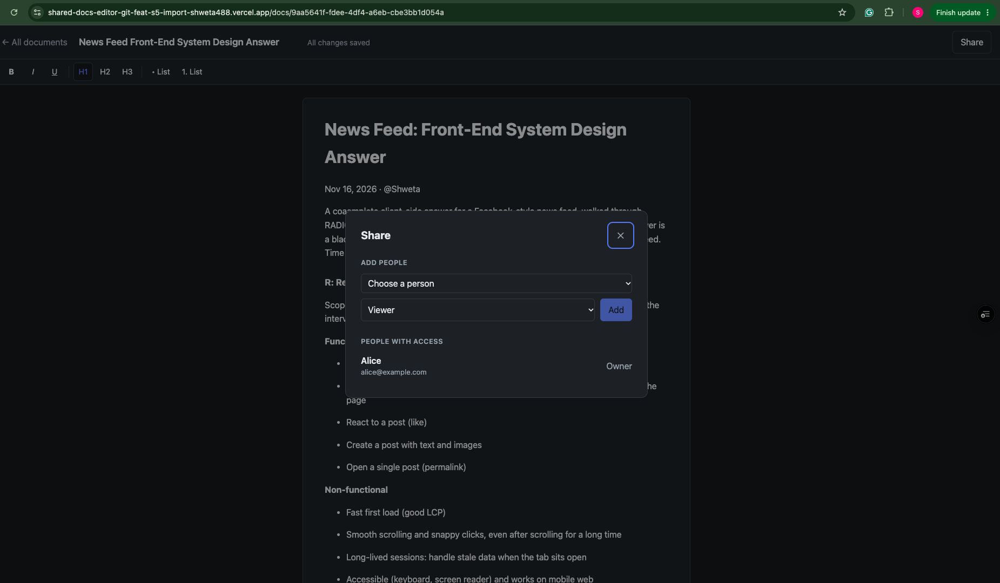
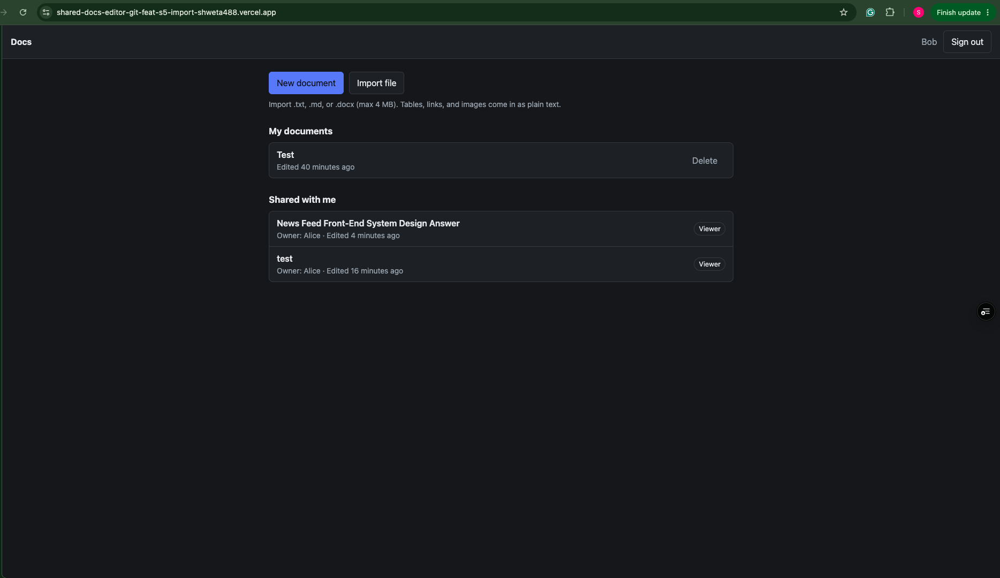

# Shared Docs Editor

A lightweight collaborative document editor: create, format, import, and share rich-text documents.
Built in a 4-hour timebox as a small product slice that works end to end.

- **Live app:** https://shared-docs-editor.vercel.app
- **Repo:** https://github.com/Shweta488/shared-docs-editor

## Test accounts

No passwords. Pick an account on the login screen.

| Account | Email | Use it to |
|---|---|---|
| Alice | alice@example.com | Own and share documents |
| Bob | bob@example.com | Receive a document as Editor |
| Carol | carol@example.com | Receive a document as Viewer |

**Suggested review flow**

1. Sign in as **Alice**. Create a document, format some text, rename it.
2. Click **Share**. Add Bob as **Editor** and Carol as **Viewer**. The dashboard shows "Shared with 2".
3. Sign out, sign in as **Bob**. The document is under **Shared with me**. Edit it; it saves.
4. Sign in as **Carol**. The document opens read-only with a "View only" badge.
5. Back as Alice, remove Carol. Her link now shows "This document doesn't exist, or you don't have access to it."

## Features

- Create, rename, edit, and delete documents. Autosave (no Save button); Cmd/Ctrl+S saves immediately.
- Rich text: bold, italic, underline, headings 1 to 3, bulleted and numbered lists.
- Dashboard with **My documents** and **Shared with me**.
- Sharing: the owner grants **Viewer** or **Editor** access, changes roles, or removes access.
- Access enforced on the server for every document route. No access returns 404; the wrong role returns 403.
- Import a file as a new document.

### Supported import types

| Type | Limit | Notes |
|---|---|---|
| `.txt` | 4 MB | Blank lines become paragraphs |
| `.md` | 4 MB | Headings, bold, italic, and lists kept |
| `.docx` | 4 MB | Headings, bold, and italic kept |

Tables, links, and code blocks come in as plain text. Images are left out. Other file types are rejected with a clear message.

## Run locally

Requires Node 20 or later.

```bash
git clone https://github.com/Shweta488/shared-docs-editor.git
cd shared-docs-editor
npm install
cp .env.example .env
npm run dev          # app on http://localhost:5173, API on http://localhost:3001
```

Locally the app uses a SQLite file (`local.db`) and seeds the three test accounts on first start. No accounts or keys needed.

```bash
npm test             # API tests (Vitest + Supertest, in-memory database)
npm run typecheck    # strict TypeScript, client and server
npm run build        # production build of the client
```

## Deploy

Hosted on **Vercel** (static client plus one serverless function for the API) with **Turso** (hosted libSQL) as the database. Both have free tiers with no card required.

Set these env vars in Vercel for both **Production and Preview**:

| Variable | What it is |
|---|---|
| `AUTH_SECRET` | Long random string used to sign login tokens |
| `TURSO_DATABASE_URL` | Turso database URL (`libsql://...`) |
| `TURSO_AUTH_TOKEN` | Turso database token |

In production the app refuses to start if any of these is missing, rather than falling back to a local file or the dev secret. The schema and seed users are created on first request.

## Docs

- [SUBMISSION.md](SUBMISSION.md): what's included, what works, known limits, next steps
- [docs/ARCHITECTURE.md](docs/ARCHITECTURE.md): architecture note, priorities, and key decisions
- [docs/AI_WORKFLOW.md](docs/AI_WORKFLOW.md): how AI was used and verified
- [docs/TESTING.md](docs/TESTING.md): test levels and the manual checklist
- Design docs: [LLD](docs/LLD.md), [UX](docs/UX.md), [implementation plan](docs/IMPLEMENTATION_PLAN.md), [working rules](RULES.md)

## Screenshots

| | |
|---|---|
| Login |  |
| Dashboard |  |
| Editor |  |
| Share dialog |  |
| Shared with me |  |
