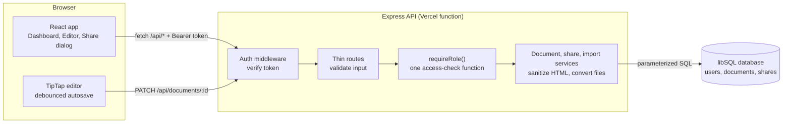

# Architecture (HLD)

A lightweight collaborative document editor: create, edit, import, and share rich-text documents. Built in a 4-hour timebox, so the goal is a small product slice that works end to end.

## What I prioritized and why

1. **Correct access control over feature count.** Sharing is where a bug hurts most, so access is decided in one server function, tested for every role on every route, and never left to the UI.
2. **A working live deploy early.** The empty app went to Vercel and Turso first (S0), so hosting problems showed up before features depended on them. One did (see decision 9).
3. **An editing experience that doesn't lose work.** Autosave with one save in flight, a visible status, and an editor limited to exactly what the server keeps, so formatting never disappears silently.
4. **Depth over breadth.** Real-time co-editing, comments, and version history were cut. Viewer and Editor roles were kept because they make sharing meaningful for little cost.
5. **Design before code.** HLD, LLD, UX, and a story plan were written and reviewed first, so AI-assisted building followed decisions I had already made.

## 1. Requirements

### 1.1 Functional (in scope)

| # | Requirement | Notes |
|---|---|---|
| F1 | Sign in as a user | Seeded demo users, no passwords (see section 6, item 1) |
| F2 | Create, rename, edit, save, reopen a document | Autosave, no Save button |
| F3 | Rich text: bold, italic, underline, H1 to H3, bulleted and numbered lists | |
| F4 | Import a `.txt`, `.md`, or `.docx` file as a new editable document | Limits shown in UI and README |
| F5 | Owner shares a document with another user as **Viewer** or **Editor** | Owner can change role or remove access |
| F6 | Dashboard separates **My documents** from **Shared with me** | Shared items show owner and access level |
| F7 | Delete a document (owner only) | |

### 1.2 Non-functional

- **Persistence:** documents, formatting, and sharing survive refresh and redeploys.
- **Security:** access rules enforced on the server, not just hidden in the UI. Stored HTML is sanitized.
- **Reliability:** clear validation and error messages; no lost edits on fast typing or navigation.
- **Reviewability:** free to run, live URL, seeded accounts, one-command local setup.

### 1.3 Out of scope (deliberate cuts)

| Cut | Why |
|---|---|
| Real-time co-editing (CRDT/websockets) | Biggest cost, least needed to show the core flows. Last write wins, documented. |
| Real auth (passwords, OAuth) | Allowed by the brief; seeded users show sharing logic just as well. |
| Comments, suggestions, version history | Out of scope for this timebox. |
| Trash and restore (soft delete) | Delete is permanent and also removes the document's shares. Needs a Trash screen to be useful. |
| Images, tables, fonts, colors | Not in the required formatting list. |
| File attachments stored on documents | Import-to-new-doc is more product-relevant and needs no file storage. |

## 2. Core entities

- **User**: `id, email, name`. Seeded: Alice, Bob, Carol.
- **Document**: `id, title, content (sanitized HTML), owner_id, created_at, updated_at`.
- **Share**: `document_id, user_id, role (viewer | editor), created_at`. One row per person per document.

Access role for a user on a document: `owner` if they own it, otherwise the share role, otherwise **no access**.

### Permissions

| Action | Viewer | Editor | Owner |
|---|---|---|---|
| Open and read | Yes | Yes | Yes |
| See who has access | No | No | Yes |
| Edit content and rename | No | Yes | Yes |
| Share, change role, remove access | No | No | Yes |
| Delete | No | No | Yes |

## 3. API (summary)

| Method | Path | Who |
|---|---|---|
| POST | `/api/auth/login` | anyone (seeded email) |
| GET | `/api/auth/me`, `/api/users` | signed in |
| GET | `/api/documents` | signed in: returns `owned` and `shared` |
| POST | `/api/documents` | signed in |
| POST | `/api/documents/import` | signed in (multipart file) |
| GET | `/api/documents/:id` | owner, editor, viewer |
| PATCH | `/api/documents/:id` | owner, editor |
| DELETE | `/api/documents/:id` | owner |
| GET | `/api/documents/:id/shares` | owner |
| PUT | `/api/documents/:id/shares` | owner (add or change role) |
| DELETE | `/api/documents/:id/shares/:userId` | owner |

Full contracts in LLD.

## 4. High-level design

The same Express app runs in three places:

| Where | Entry point | Database |
|---|---|---|
| Local dev | Node server, Vite proxies `/api` | `file:local.db` |
| Tests | App imported by Supertest | `:memory:` |
| Production | Vercel function (exact entry decided in S0) | Turso (hosted libSQL) |

Request path for an edit: editor change → debounced autosave (800 ms) → `PATCH /api/documents/:id` → token verified → role checked (owner/editor) → HTML sanitized → row updated → "All changes saved".

## 5. Tech stack and why

| Layer | Choice | Why |
|---|---|---|
| Frontend | React + TypeScript (Vite) | My strongest stack; fast build |
| Editor | TipTap (ProseMirror) | Covers every required format out of the box; schema-based, so it only renders allowed nodes |
| API | Express (Node) + TypeScript, run with `tsx` | Small, well known, easy to test with Supertest; runs locally and as a Vercel function. One language across the stack. |
| Validation | zod | Request bodies checked against a schema in each route, with clear 400 errors and typed results |
| Import | `mammoth` (.docx), `marked` (.md), plain paragraphs (.txt) | Each converts to HTML, then goes through the same sanitizer as editor saves |
| DB | libSQL / Turso | Same SQL and client for local file, in-memory tests, and hosted prod. Free, no card. |
| Hosting | Vercel | Free, no idle sleep, deploys from GitHub |
| Tests | Vitest + Supertest (API). Playwright smoke test is optional, if time allows. | Permission logic is the highest-risk area, so it gets the most tests |
| CI | GitHub Actions | Runs typecheck and tests on every PR |

## 6. Key decisions

1. **Mocked auth with signed tokens.** Login picks a seeded user; the server returns an HMAC-signed token. Every API call verifies it. Real enough to enforce access, cheap to build. Env vars: `AUTH_SECRET` (signs tokens), `TURSO_DATABASE_URL` and `TURSO_AUTH_TOKEN` (production database).
2. **Viewer / Editor roles** (beyond the minimum "grant access"). Small extra cost, and it makes the sharing model meaningful. This also covers the brief's stretch item "role-based sharing beyond basic access".
3. **404, not 403, for documents you can't access**, so other users can't tell a document exists.
4. **Store sanitized HTML** (allow-list matching the editor's formats). Import produces HTML anyway, it is readable in the DB, and sanitizing on the server covers both editor saves and imported files.
5. **Import creates a new document** rather than attaching files. No blob storage needed; the most useful upload behavior for a docs product.
6. **Upload limit 4 MB**: Vercel functions cap request bodies at 4.5 MB.
7. **Autosave with a single in-flight request** so fast typing never writes out of order; unsaved-changes warning on tab close.
8. **Last write wins** for simultaneous edits: each save overwrites the whole document body, so one person's save can replace another's changes. Documented as a known limit; optimistic locking is the first "next step".

Decisions made during the build:

9. **`sanitize-html` pinned to exactly 2.17.0.** Version 2.18 loads an ESM-only parser with `require()`, which works on local Node but crashed the Vercel function on start. 2.17.0 uses a CommonJS parser. A test now loads every server package in plain Node with `require()` of ESM turned off, so this class of bug fails before deploy.
10. **The access list is owner-only.** `GET /documents/:id/shares` returns 403 for editors and viewers, because the list includes other people's emails. Editors and viewers see their own role and the owner's name instead.

## 7. Risks

| Risk | Mitigation |
|---|---|
| Vercel + Express config issues eat time | Deploy the skeleton first (S0), before features |
| Multipart uploads fail on Vercel functions if the body is parsed before `multer` | Test import on the deployed preview right after the import story, not at the end |
| Turso setup blocks deploy | Turso is set up before S0, so there is no runtime fallback. |
| Timebox overrun | Stories ordered by requirement priority; nothing extra until core is done |
